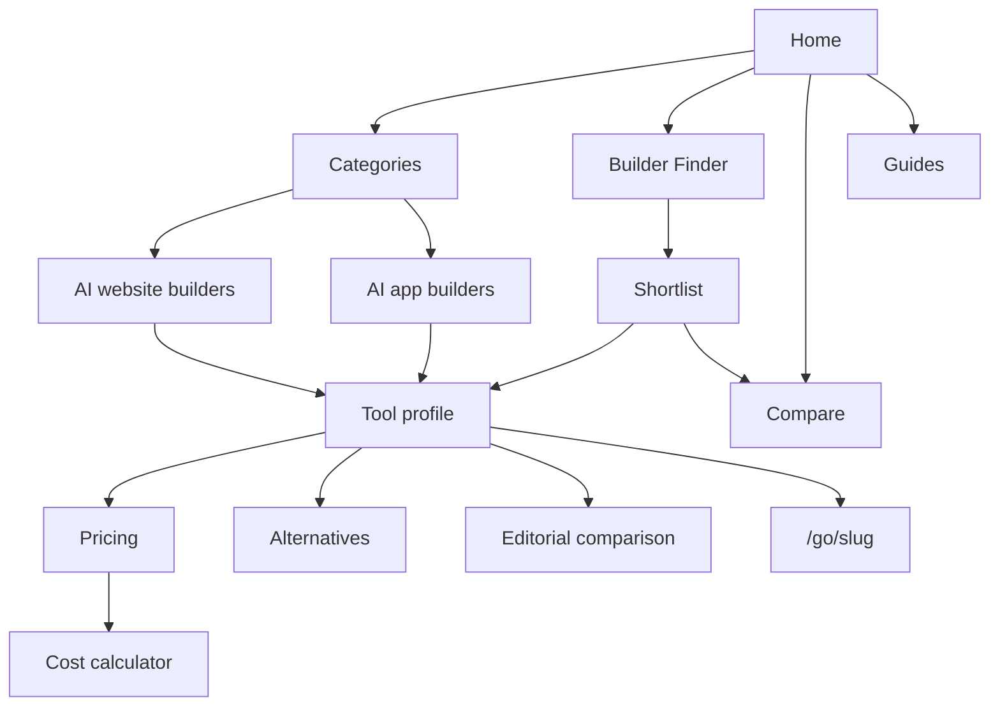

# Plan

## Mission

Buildsieve (provisional name) helps people choose an AI website or app builder with confidence. It answers one question: which AI builder gets my site or app live fastest, at a price I can keep paying, without locking me in?

Every profile is researched from the vendor's own pages, never hands-on tested, and says so. Every price shows the intro price, the term, the renewal price and year one and year three totals, with the date and source. The Research Score is computed by code from sourced facts, so any reader can recompute it. Affiliate links, once approved, are labeled and never change a score, an order or a Finder result. Unknown stays unknown: a gap is shown, never filled.

## Status (October 28, 2026)

The owner asked for the complete site in one pass instead of the phase-by-phase approval loop. Phases 0 to 4 are built, Phase 5 is partly built (first content batch), Phases 6 and 7 are open. See "Open items" below.

| Phase | State |
| --- | --- |
| 0 Foundation | Done: latest stack, config, scripts, docs, noindex. Brand name provisional. No git commit yet (waiting for the owner). |
| 1 Design system | Tokens, components, logo mark built. One primary color chosen (petrol `#0E7490`); styleguide page with 3 color and 3 logo options not built. |
| 2 Content layer | Done: Zod schemas, YAML loader, build guards, copy lint, score, search index, 24 unit tests. |
| 3 Templates | Done: all templates in Section 7 except `/newsletter` (flag off) and `/internal/styleguide`. |
| 4 Interactivity | Done: Finder, compare tool, cost calculator, filters, palette, `/go` redirect. Contact form and newsletter stay hidden until a provider exists. |
| 5 Content | Partly: 11 profiles, 2 comparisons, 3 best-for pages, 3 guides, 8 glossary terms. Target is 10 per category and 8 guides. |
| 6 Hardening | Open: OG images, CSP headers, Lighthouse, Playwright and axe E2E. |
| 7 Launch | Open. |

## Information architecture

| Page type | URL | Built |
| --- | --- | --- |
| Home | `/` | yes |
| Category hub | `/categories` | yes |
| Category page | `/best/ai-website-builders`, `/best/ai-app-builders` | yes |
| Tool profile | `/reviews/[slug]` | yes |
| Pricing | `/reviews/[slug]/pricing` | yes |
| Alternatives | `/reviews/[slug]/alternatives` (noindex) | yes |
| Comparison | `/compare/[slug]` | yes (2) |
| Comparison tool | `/compare` | yes |
| Best for | `/best-for/[slug]` | yes (3) |
| Builder Finder | `/builder-finder`, `/builder-finder/results` (noindex) | yes |
| Cost calculator | `/cost-calculator` | yes |
| Guides | `/guides`, `/guides/[slug]` | yes (3) |
| Glossary | `/glossary`, `/glossary/[slug]` | yes (8) |
| Trust pages | `/methodology`, `/how-we-make-money`, `/editorial-policy`, `/team`, `/about`, `/contact` | yes |
| Legal | `/privacy`, `/terms`, `/cookie-settings`, `/accessibility` | drafts, need lawyer review |
| Search | `/search` (noindex) | yes |
| Affiliate redirect | `/go/[slug]` | yes, falls back to profile while the flag is off |

## Research Score proposal (R1.0, needs owner approval)

AI capabilities 25%, core features for the category 25%, true cost 20%, ownership and portability 15%, trust and support 15%. Points: yes 1, paid add-on 0.75, partly 0.5, beta 0.25, no and unknown 0. Price part: 0.8 at or below $10/mo averaged over 36 months, falling to 0 at $60/mo (website builders) or $150/mo (app builders); free plan adds 0.2.

## Brand name proposals

Checked with Verisign RDAP (`https://rdap.verisign.com/com/v1/domain/<name>.com`) on October 28, 2026. 404 means no registration record; 200 means registered.

| Name | Result |
| --- | --- |
| buildsieve.com | 404, not registered (used as provisional name) |
| buildwell-guide.com | 404, not registered (hyphen, weaker) |
| buildlens.com, plainbuild.com, buildcandor.com, sitecandor.com, buildledger.com, fairbuild.com, buildscout.com, pickabuilder.com, buildernote.com, sitesieve.com, builderwise.com, sitepicker.com, buildmeter.com, buildtally.com, sitetally.com, buildroster.com, costofbuild.com | 200, registered |

The owner registers the domain; availability can change at any time.
